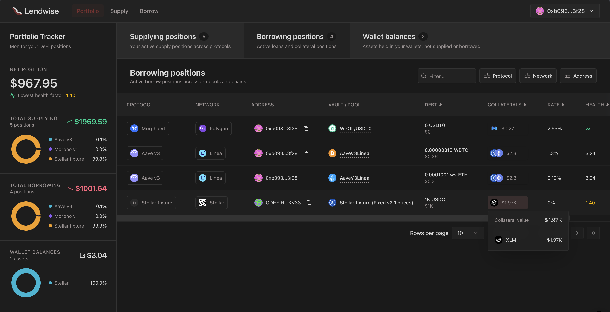
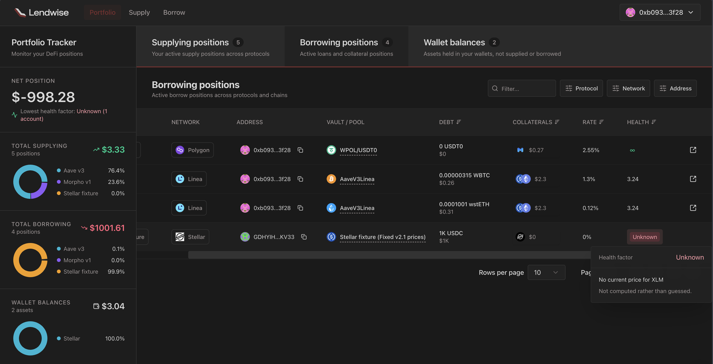
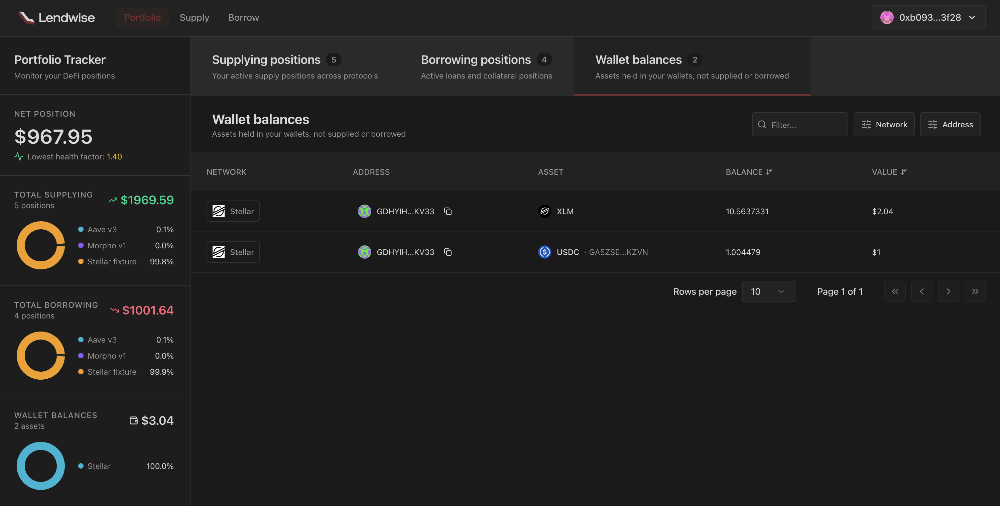
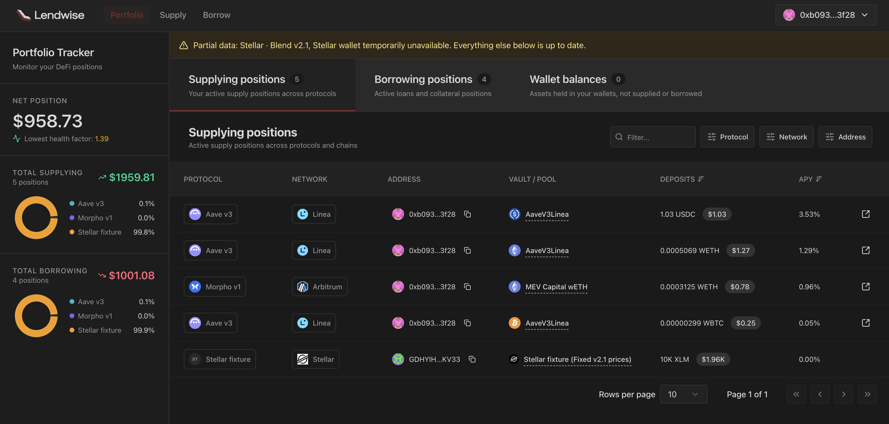

# SCF #45 — Milestone 2 (Tranche 2, Testnet)

Evidence for the two Tranche 2 deliverables of LendWise's
[Stellar Community Fund #45 submission](https://communityfund.stellar.org/submissions/recmK8tdxCKvSU3GS)
(Tranche 2, "Testnet", $12,430): each success criterion, and where to check it — in this public
repository, on a staging environment, and on [lendwise.fi](https://lendwise.fi).

| Deliverable                                                                                                                        | Success criterion                                                                                                                                                                                                           | Status                                                                 |
| ---------------------------------------------------------------------------------------------------------------------------------- | --------------------------------------------------------------------------------------------------------------------------------------------------------------------------------------------------------------------------- | ---------------------------------------------------------------------- |
| [1 — Standardized health-factor & risk module, portfolio UI](#1--standardized-health-factor--risk-module-portfolio-ui) ($5,650)    | Unit-test suite passing in CI over multiple reserve/oracle scenarios including an unpriced asset; on staging, a fixture Stellar adapter shows a computed health factor for a Stellar address, and "unknown" without a price | Delivered (staging)                                                    |
| [2 — EVM + Stellar portfolio merge with graceful degradation](#2--evm--stellar-portfolio-merge-with-graceful-degradation) ($6,780) | EVM Aave position and Stellar USDC in the same portfolio view; with the Stellar endpoint unreachable, the page still renders the EVM side with the partial-data indicator                                                   | Delivered (staging) — lendwise.fi check pending the production release |

**Staging:** [lendwise-web-git-mainnet-smarttdev.vercel.app](https://lendwise-web-git-mainnet-smarttdev.vercel.app)
(Vercel preview of the `mainnet` branch). **CI:** the latest green run on `mainnet`,
[run 38232534999](https://github.com/lendwise-fi/lendwise/actions/runs/38232534999), commit
`cc517b0`.

**Network.** The demonstrations run on Stellar **mainnet**, not testnet. Blend v1 and v2 have been
frozen or on ice since the exploit, and Blend v2.1 is live on mainnet; the staging fixture
therefore serves a mainnet address. The fixture's positions are synthetic; its prices are the real
Blend v2.1 Fixed pool oracle prices, read from the spot pipeline.

---

## 1 — Standardized health-factor & risk module, portfolio UI

> **Success criteria:** The module ships with its unit-test suite passing in CI, covering
> multiple reserve/oracle scenarios including an unpriced asset. On a staging environment, a
> fixture Stellar adapter registered through the adapter contract exposes known positions and
> per-reserve risk weights for a Stellar testnet address; the portfolio page shows, for that
> address, the health factor the module computes from them, and the "unknown" state when one
> reserve's price is removed from the oracle map.

### What was built

| Proposal item                                                                    | Where                                                                                                                                                                                                                                                                                                   |
| -------------------------------------------------------------------------------- | ------------------------------------------------------------------------------------------------------------------------------------------------------------------------------------------------------------------------------------------------------------------------------------------------------- |
| **Standardized health-factor formula and its states** (including "unknown")      | [`src/lib/risk/health-factor.ts`](../src/lib/risk/health-factor.ts), types in [`src/lib/risk/types.ts`](../src/lib/risk/types.ts)                                                                                                                                                                       |
| **Prices from the spot pipeline** — no second oracle round                       | [`src/lib/risk/prices.ts`](../src/lib/risk/prices.ts); computation in [`src/lib/risk/compute.ts`](../src/lib/risk/compute.ts); portfolio summary in [`src/lib/risk/summary.ts`](../src/lib/risk/summary.ts)                                                                                             |
| **Adapter contract** — an adapter exposes positions and per-reserve risk weights | `getRiskAccounts` and `StellarPositionsAdapter` in [`src/lib/protocols/core/types.ts`](../src/lib/protocols/core/types.ts)                                                                                                                                                                              |
| **Blend v2.1 adapter** and **Stellar fixture adapter**, registered the same way  | [`src/lib/protocols/blend/v2_1/positions.ts`](../src/lib/protocols/blend/v2_1/positions.ts); [`src/lib/protocols/stellar/fixture/index.ts`](../src/lib/protocols/stellar/fixture/index.ts); registry `stellarPositionAdapters` in [`src/config/protocols-server.ts`](../src/config/protocols-server.ts) |
| **Morpho** risk accounts, with the collateral price from the spot pipeline       | [`src/lib/protocols/morpho/v1/risk.ts`](../src/lib/protocols/morpho/v1/risk.ts); [`src/lib/protocols/morpho/v1/apy-spot.ts`](../src/lib/protocols/morpho/v1/apy-spot.ts)                                                                                                                                |
| **Portfolio UI** — health factor and its states                                  | [`HealthFactorValue.tsx`](../src/components/portfolio/HealthFactorValue.tsx), [`Portfolio.tsx`](../src/components/portfolio/Portfolio.tsx), [`PortfolioSidebar.tsx`](../src/components/portfolio/PortfolioSidebar.tsx), [`BorrowingTable.tsx`](../src/components/portfolio/BorrowingTable.tsx)          |
| **Daily aggregation** of the new hourly rows, with no change                     | `aggregateDaily` in [`src/lib/db/repositories/apy.ts`](../src/lib/db/repositories/apy.ts#L242) groups `apy_hourly` by `product_id` with no protocol filter, so any protocol writing hourly rows is covered                                                                                              |

### Tests (CI)

The [CI workflow](../.github/workflows/ci.yml) runs format, lint, codegen, tests and typecheck;
the latest green run on `mainnet` is
[38232534999](https://github.com/lendwise-fi/lendwise/actions/runs/38232534999) (`cc517b0`).

| Test file                                                                                                                                                           | What it pins                                                                                                                                                                                                                                                                                                      |
| ------------------------------------------------------------------------------------------------------------------------------------------------------------------- | ----------------------------------------------------------------------------------------------------------------------------------------------------------------------------------------------------------------------------------------------------------------------------------------------------------------- |
| [`risk/health-factor.test.ts`](../src/lib/risk/health-factor.test.ts)                                                                                               | The formula and its states over multiple reserve/oracle scenarios, including an unpriced asset (the "unknown" state)                                                                                                                                                                                              |
| [`risk/compute.test.ts`](../src/lib/risk/compute.test.ts), [`prices.test.ts`](../src/lib/risk/prices.test.ts), [`summary.test.ts`](../src/lib/risk/summary.test.ts) | Computation from risk accounts and a price map, price resolution from the spot pipeline, portfolio summary                                                                                                                                                                                                        |
| [`risk/__tests__/aave-validation.test.ts`](../src/lib/risk/__tests__/aave-validation.test.ts)                                                                       | External validation against Aave: the public Aave v3 Ethereum Core account `0x60b2dc238f9ee37eb5a7549842febef8233748ba` (outside e-mode, 4 collaterals / 3 debts, [snapshot](../src/lib/risk/__tests__/fixtures/aave-snapshot.json)); the computed health factor matches the 1.36845 Aave reports, within 1e-14 % |
| [`morpho/v1/__tests__/risk.test.ts`](../src/lib/protocols/morpho/v1/__tests__/risk.test.ts)                                                                         | Morpho cross-check of the same formula                                                                                                                                                                                                                                                                            |

### Staging demonstration

The fixture adapter serves one configured address,
`GDHYIHAZ5URVB5TUKLREMPFGH4AYMIMON5KHXKKNYLTYGLUECF4OKV33`, registered through the same adapter
contract as Blend. Its synthetic account sits in the Blend v2.1 Fixed pool
[`CBAKAZUEJBAFA2DCGBRS2WKJT3FNIMJBHTFL76AY7XMAVEINQNNIQWAO`](https://mainnet.blend.capital/dashboard/?poolId=CBAKAZUEJBAFA2DCGBRS2WKJT3FNIMJBHTFL76AY7XMAVEINQNNIQWAO):

| Side       | Position   | Risk weight       |
| ---------- | ---------- | ----------------- |
| Collateral | 10,000 XLM | 0.75 (collateral) |
| Debt       | 1,000 USDC | 0.95 (`l_factor`) |

The expected health factor follows from the formula and the live oracle prices:

```
HF = 10000 × p_XLM × 0.75 / (1000 × p_USDC ÷ 0.95)
```

**Health factor computed from the fixture** — the value on the page matches the formula above for
the prices shown.



**"Unknown" state** — the XLM price removed from the oracle map.



_With the XLM price removed, the fixture's XLM collateral is also valued at $0 in the supply table
and the net position. This is expected: the point of the capture is the Unknown health factor._

---

## 2 — EVM + Stellar portfolio merge with graceful degradation

> **Success criteria:** For a user with a connected EVM wallet holding an Aave position and a
> connected Stellar wallet holding USDC, the portfolio page shows both in the same view — a
> reviewer can check this with their own wallets on lendwise.fi. The degradation path is
> demonstrated by the team on a staging environment with the Stellar endpoint made unreachable:
> the same page still renders the EVM side with the partial-data indicator, with a recording or
> screenshots provided with the submission.

### What was built

| Proposal item                                                                       | Where                                                                                                                                                                                                                                                                                                                                                                                      |
| ----------------------------------------------------------------------------------- | ------------------------------------------------------------------------------------------------------------------------------------------------------------------------------------------------------------------------------------------------------------------------------------------------------------------------------------------------------------------------------------------ |
| **Merge of EVM and Stellar sources**, each failing independently                    | [`src/lib/portfolio/load.ts`](../src/lib/portfolio/load.ts) — a two-level `Promise.allSettled`, a per-source time limit, and generic client messages (no internal error text reaches the browser); routing in [`src/lib/portfolio/routing.ts`](../src/lib/portfolio/routing.ts); server action [`src/app/actions/user-portfolio.actions.ts`](../src/app/actions/user-portfolio.actions.ts) |
| **Stellar wallet holdings** (USDC and other balances, outside any lending protocol) | [`src/lib/stellar/wallet-holdings.ts`](../src/lib/stellar/wallet-holdings.ts), shown by [`StellarHoldings.tsx`](../src/components/portfolio/StellarHoldings.tsx)                                                                                                                                                                                                                           |
| **Partial-data indicator**                                                          | [`PartialDataBanner.tsx`](../src/components/portfolio/PartialDataBanner.tsx), rendered by [`Portfolio.tsx`](../src/components/portfolio/Portfolio.tsx)                                                                                                                                                                                                                                     |

### Staging demonstration

**Merged view** — EVM and Stellar in the same portfolio page.



**Degradation** — the Stellar endpoint made unreachable: the page still renders the EVM side, with
the partial-data banner.



[Recording of the degradation path](scf-45/t2-degradation.mp4).

### Reviewer walkthrough on lendwise.fi

1. Open [lendwise.fi](https://lendwise.fi) and connect an EVM wallet holding an Aave position.
2. Connect a Stellar wallet holding USDC (see [Milestone 1](scf-45-milestone-1.md#2--stellar-wallet-connection--sep-10-auth) for the sign-in).
3. Open the portfolio page: both sides appear in the same view.

---

## Pending

The lendwise.fi capture (an EVM Aave position and Stellar USDC in one view) will be added once
`mainnet` is released to production, which is held until the Tranche 1 review on lendwise.fi
completes.

## Related

- [Milestone 1 evidence](scf-45-milestone-1.md)
- [Architecture of the Stellar integration](architecture-stellar-integration.md)
